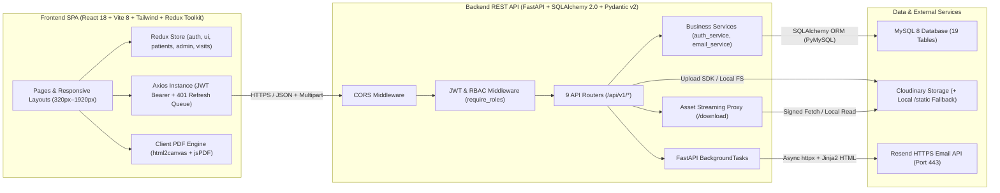
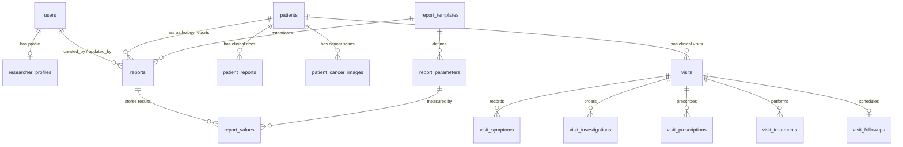
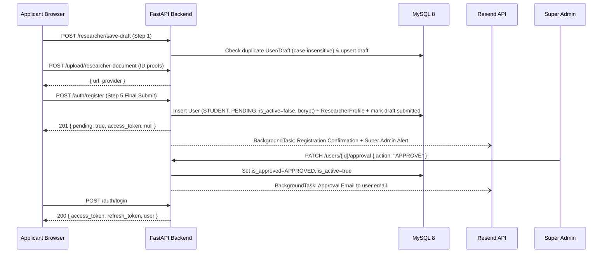

# Onco Sphere — System Architecture

This document explains the end-to-end technical architecture of **Onco Sphere**, derived directly from the frontend (`helix-frontend`), backend (`helix-backend`), and MySQL 8 database schema.

---

## 1. High-Level Architecture Diagram

---

## 2. Frontend Architecture (`helix-frontend`)

### 2.1 Layered Design
1. **Entry & Global Shell (`main.jsx`, `App.jsx`):**
   - Wraps the app in Redux `<Provider>` and Sonner `<Toaster>`.
   - Applies persisted theme/appearance on boot (`applyStoredAppearance`) and guards against browser back-forward cache (`bfcache` `pageshow`) after logout.
2. **Routing & RBAC Guard (`src/routes/index.jsx`, `RequireAuth.jsx`):**
   - **Public routes:** `/`, `/login`, `/forgot-password`, `/reset-password`, `/register/apply`.
   - **Authenticated routes (all roles):** `/dashboard`, `/patients`, `/patients/:id`, `/visits/:visitId`, `/settings`.
   - **Admin & Super Admin routes (`['ADMIN', 'SUPER_ADMIN']`):** `/patients/new`, `/patients/:id/edit`, `/admin-management`, `/reports`, `/reports/new`, `/reports/edit/:id`, `/reports/settings`, `/reports/print/:id`.
3. **Layout Shell (`AppLayout.jsx` / `AppLayout.css`):**
   - Floating glassmorphic top navigation bar + gliding collapsible left sidebar on desktop + mobile slide-over drawer.
   - Dynamic sidebar filtering based on `user.role`.
4. **State Management (`src/redux/`):**
   - `authSlice`: User profile, authentication status, login/register/getMe/logout thunks. Pending registrations intentionally do **not** persist null tokens or set `isAuthenticated = true`.
   - `uiSlice`: Sidebar open/collapsed state and layout UI flags.
   - `patientSlice`: Patient registry list, pagination, filters, and CRUD thunks.
   - `adminSlice`: User directory, approval/rejection actions, and role management thunks.
   - `visitSlice`: Mounted in store alongside direct `visitService` calls.
5. **Service & HTTP Layer (`src/services/axiosInstance.js`):**
   - Automatically attaches `Authorization: Bearer <token>` from `localStorage`.
   - Intercepts `401 Unauthorized` responses (excluding `/auth/login` and `/auth/refresh`), queues concurrent failed requests, exchanges `helix_refresh_token` at `POST /api/v1/auth/refresh`, retries queued requests with the fresh access token, or cleanly logs out to `/login`.

---

## 3. Backend Architecture (`helix-backend`)

### 3.1 Layered FastAPI Design
1. **Application Entry (`main.py`):**
   - Configures structured logging and CORS allowlist (`localhost:5173/5174/4173/3000`, Vercel production origins, and `settings.FRONTEND_URL`).
   - Uses FastAPI `lifespan` startup to run `Base.metadata.create_all()` and idempotent `CREATE TABLE IF NOT EXISTS` / `ALTER TABLE` guards for MySQL 8 compatibility.
   - Mounts all 9 routers under `/api/v1` and exposes `/static` for local upload fallback.
2. **Configuration (`app/config/settings.py`):**
   - `pydantic-settings` loads `.env` once via `@lru_cache()` (DB URL, JWT secrets/expiry, Cloudinary credentials, Resend API config, email subjects/retry policy).
3. **Database Layer (`app/database/db.py`):**
   - SQLAlchemy 2.0 engine (`mysql+pymysql`) with SSL CA support (`ca.pem` for Aiven Cloud MySQL) and per-request `get_db()` session dependency.
4. **Authentication & RBAC (`app/middleware/auth.py`, `app/utils/jwt.py`, `app/utils/password.py`):**
   - `get_current_user`: Extracts and validates HS256 JWT Bearer token, verifies active user in DB.
   - `require_roles([...])`: Dependency factory enforcing role-level authorization (`SUPER_ADMIN`, `ADMIN`, `STUDENT`) on every protected route.
   - Password hashing: `bcrypt` (12 rounds, 72-byte safe truncation) with `passlib` legacy verification fallback.
5. **Async Email Subsystem (`app/services/email_service.py`):**
   - Uses Resend HTTPS API (port 443, firewall/Render-friendly) via async `httpx.AsyncClient`.
   - Runs in FastAPI `BackgroundTasks` so API latency is never blocked by email delivery.
   - Implements exponential-backoff retry (default 3 attempts) on network errors, `429`, and `5xx`, with per-email `Idempotency-Key` headers and masked-email structured logging.
   - Renders 7 Jinja2 HTML templates (`base.html`, `registration_confirmation.html`, `admin_new_application.html`, `otp_verification.html`, `approval.html`, `rejection.html`, `password_reset_otp.html`).

---

## 4. Database Schema & Relationships (MySQL 8 — 19 Tables)

| Domain | Tables (19 Total) | Purpose |
|---|---|---|
| **Identity & Access** | `users` (14 cols), `researcher_profiles` (22 cols, FK `user_id → users.id`), `researcher_drafts` (9 cols) | Accounts, RBAC roles, approval state, bcrypt hashes, 5-step researcher credentials, OTP draft resume |
| **Patient Registry** | `patients` (27 cols), `patient_reports` (6 cols), `patient_cancer_images` (6 cols) | Sequential `ICSR-XXXXX` patients, oncology diagnosis/staging, uploaded PDFs & scan images |
| **Clinical Visits** | `visits` (17 cols), `visit_symptoms` (8 cols), `visit_investigations` (6 cols), `visit_prescriptions` (7 cols, JSON medicines), `visit_treatments` (6 cols), `visit_followups` (6 cols) | End-to-end OPD/inpatient clinical encounter tracking |
| **Onco Receipt (Reports)** | `report_templates` (6 cols), `report_parameters` (9 cols), `reports` (20 cols), `report_values` (6 cols), `report_audit_logs` (7 cols), `doctor_signatures` (5 cols), `institute_info` (9 cols) | Versioned pathology/oxidative biomarker reports, master reference ranges, audit history, signatures & institute branding |

---

## 5. Complete API Endpoint Map (`/api/v1`)

| Module | Base Path | Endpoints | Access Level |
|---|---|---|---|
| **Health** | `/api/v1/health` | `GET /health` | Public |
| **Auth** | `/api/v1/auth` | `POST /login`, `POST /register`, `POST /refresh`, `POST /logout`, `GET /me`, `POST /forgot-password`, `POST /verify-reset-otp`, `POST /reset-password` | Public (except `/me`, `/logout`) |
| **Researcher Drafts** | `/api/v1/researcher` | `POST /save-draft`, `PUT /update-draft/{draft_id}`, `POST /request-otp`, `POST /verify-otp` | Public |
| **Users & Governance** | `/api/v1/users` | `GET /`, `POST /`, `PUT /profile`, `PUT /{user_id}`, `PATCH /{user_id}/status`, `PATCH /{user_id}/approval`, `POST /{user_id}/change-password`, `DELETE /{user_id}` | `ADMIN`, `SUPER_ADMIN` (self for `/profile`, `/change-password`) |
| **Dashboard** | `/api/v1/dashboard` | `GET /stats` | Authenticated (all roles) |
| **Patients** | `/api/v1/patients` | `GET /`, `POST /`, `GET /{id}`, `PUT /{id}`, `DELETE /{id}`, `GET/POST/DELETE /{id}/reports`, `GET/POST/PATCH/DELETE /{id}/cancer-images`, `GET /{id}/reports/{rid}/download`, `GET /{id}/cancer-images/{iid}/download` | Read: All roles; Write: `ADMIN`, `SUPER_ADMIN` |
| **Visits** | `/api/v1/visits` | `GET /`, `POST /`, `GET /patient/{pid}`, `GET /{vid}`, `PATCH /{vid}/status`, `POST /{vid}/check-in`, `GET/POST /{vid}/{symptoms,investigations,prescriptions,treatments,followup}`, `DELETE /{vid}` | Authenticated + role-guarded mutations |
| **Onco Receipt** | `/api/v1/reports` | `GET /templates`, `GET/POST /settings`, `POST/PUT/DELETE /signature`, `POST/PUT /parameters`, `POST /parameters/reset`, `GET/POST/DELETE /`, `GET /{id}`, `POST /{id}/print-log`, `GET /history/{report_number}`, `GET /versions/{report_number}` | `ADMIN`, `SUPER_ADMIN` |
| **Uploads & Storage** | `/api/v1/upload` | `GET /status`, `GET /storage`, `POST /image`, `POST /document`, `POST /researcher-document` | Public for `/researcher-document`; Auth/Admin for others |

---

## 6. Key End-to-End Workflows

### 6.1 Researcher Registration, Approval & Login Workflow

### 6.2 Oxidative Stress Pathology Report & PDF Workflow
1. Clinician opens `/reports/new` (or `/reports/edit/:id`), selects a patient (auto-populates demographics) or enters manual patient details, and enters biomarker readings.
2. Each parameter is evaluated in real time against master reference ranges from `report_parameters`, flagging `LOW` / `NORMAL` / `HIGH` statuses and calculating summary clinical impressions.
3. **Desktop (`>=768px`):** Displays a live split-screen A4 preview (`OxidativeReportDocument`) synchronized on every keystroke, plus Print, Download PDF, Sample Values, History, and Save Document actions.
4. **Mobile (`<768px`):** Hides the inline A4 preview to eliminate horizontal overflow and heavy continuous re-rendering; keeps a compact History back button at top and a prominent full-width **Save Clinical Report** button at the bottom. On-demand PDF export renders the A4 document cleanly offscreen via `html2canvas` (`scale: 2`) → `jsPDF` (A4 portrait).
5. Saving calls `POST /api/v1/reports`, which auto-generates/increments report versions and writes an immutable entry to `report_audit_logs`.
